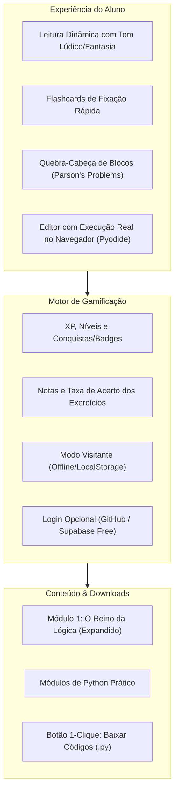

# 🚀 Arquitetura do Novo Guia Gamificado: "Python para Todos"
> **Autora & Idealizadora:** Aya Nicodemos — Ayasoft Studios  
> **Modelo:** 100% Gratuito, Open Source, Hospedado no GitHub (GitHub Pages / Vercel)  
> **Público:** Crianças, jovens e adultos iniciantes (aprendizado lúdico e sem frustração)

---

## 1. Visão Geral da Plataforma

O novo guia deixará de ser apenas uma apostila estática e se tornará uma **plataforma interativa de aprendizado gamificado**, inspirada na fluidez do GitBook/Duolingo/Codecademy, mantendo a filosofia do **Zero Custo de Hospedagem** e **Zero Atrito para o Aluno**.

---

## 2. A Tecnologia do Projeto (100% Gratuita e Serverless)

Para hospedar no GitHub sem gastar **nenhum centavo** com servidores:

| Recurso | Solução Recomendada | Por que funciona tão bem? |
| :--- | :--- | :--- |
| **Hospedagem** | GitHub Pages (ou Vercel / Cloudflare Pages) | Custo zero, CDN global rápida, CI/CD automático ao dar `git push`. |
| **Framework Web** | **Astro + Starlight (com componentes React/Svelte)** ou **Next.js estático** | Excelente para documentação e livros, suporte nativo a Markdown/MDX, incrivelmente rápido e responsivo. |
| **Execução de Python no Navegador** | **Pyodide (WebAssembly)** | Roda Python **real** diretamente dentro do navegador do aluno via WebAssembly. **Zero servidores**, seguro, rápido e não consome dados nem dinheiro de backend. |
| **Interatividade (Quebra-Cabeça)** | **Parson's Problems (Drag & Drop de Blocos)** | Excelente pedagogia para iniciantes: a pessoa encaixa as linhas de código na ordem lógica correta antes de ter que digitar sintaxe complexa. |
| **Sistema de Login & Progresso** | **Local-First (IndexedDB/LocalStorage) + Supabase/GitHub OAuth (Opcional)** | O aluno já entra jogando e salvando notas sem precisar criar conta. Se quiser sincronizar entre celular e PC, pode fazer login com GitHub ou e-mail gratuito. |

---

## 3. Os 3 Tipos de Desafios Gamificados em Cada Capítulo

Cada capítulo terminará com uma "Arena de Desafios":

1. **🃏 Cartas do Conhecimento (Flashcards Interativos):**
   * Pergunta na frente, clique para virar e ver a explicação lúdica.
   * O aluno marca se "Acertei com facilidade", "Tive dúvida" ou "Errei", calculando a pontuação.

2. **🧩 Quebra-Cabeça de Código (Blocos de Feitiço):**
   * O código vem embaralhado em blocos visuais.
   * O aluno arrasta e organiza os blocos na ordem correta para resolver o enigma (ex: declarar variável ➔ somar ➔ exibir).

3. **💻 Terminal do Mago (Editor com Avaliação em Tempo Real):**
   * Um mini-editor onde o aluno digita o código Python real.
   * O motor no navegador executa testes automatizados sobre o código e retorna:
     * Taxa de acerto (ex: *100% de precisão!*);
     * Mensagens amigáveis de feedback em vez de erros crípticos;
     * XP e notas somadas ao perfil do aluno.

4. **📥 Baixar Feitiço (.py):**
   * Um botão discreto e acessível para baixar o arquivo `.py` daquele exercício já formatado para rodar no computador dele offline.

---

## 4. Reestruturação do Módulo 1: "O Reino da Lógica"

O Módulo 1 será o coração conceitual do guia, mantendo o universo de fantasia e metáforas mágicas que você criou:

* **Fase 1: O que é um Computador?**
  * O computador não é um gênio onipotente; é um servo incrivelmente veloz que obedece ordens ao pé da letra (o *"Golems de Pedra"* que precisa de instruções perfeitas).
* **Fase 2: As Caixinhas Encantadas (Variáveis & Tipos de Dados)**
  * A bolsa mágica onde guardamos Números (moedas de ouro), Textos (pergaminhos com aspas) e Booleanos (lâmpadas acesas ou apagadas).
* **Fase 3: Os Portais da Decisão (Operadores & Estruturas Condicionais - `Se / Senão`)**
  * O guardião da ponte que só deixa passar quem tem a chave ou senha correta.
  * Comparações `>`, `<`, `==`, `!=` e os conectores `E` (`and`) e `OU` (`or`).
* **Fase 4: O Feitiço da Repetição (Laços `Enquanto` e `Para`)**
  * A esteira mágica que carimba itens repetitivos sem cansar.
  * A diferença entre repetir enquanto uma condição for verdade vs. repetir para cada item de uma lista.
* **Fase 5: O Baú de Inventário (Conceito Lógico de Listas & Coleções)**
  * Como organizar múltiplos itens numa mesma mochila mágica antes de entrar no código Python.
* **Fase 6: O Livro de Receitas / Feitiços (Conceito Lógico de Funções)**
  * Criando seus próprios rituais que recebem ingredientes e devolvem poções prontas.

---

## 5. Roteiro de Implementação Proposto

1. **Etapa 1 (Conteúdo Base):**
   * Expandir e reescrever o **Módulo 1 (Lógica de Fantasia)** em Markdown nos moldes do nosso Guia de Estilo.
   * Adicionar os blocos de perguntas, desafios de quebra-cabeça e exercícios práticos em formato estruturado.

2. **Etapa 2 (Protótipo da Plataforma Web):**
   * Configurar a estrutura do projeto web (ex: Astro + Starlight ou Next.js) no repositório.
   * Criar os componentes interativos: Flashcard, Parson's Problem (quebra-cabeça) e Runner Pyodide (Python no browser).

3. **Etapa 3 (Gamificação & Identidade Ayasoft):**
   * Implementar o sistema de XP, notas, perfil do aluno e armazenamento local.
   * Design visual acolhedor, limpo e mágico (paleta moderna da Ayasoft).
